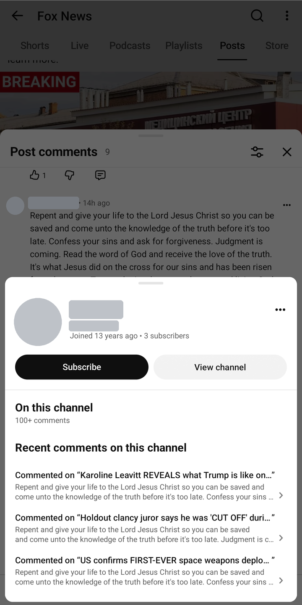
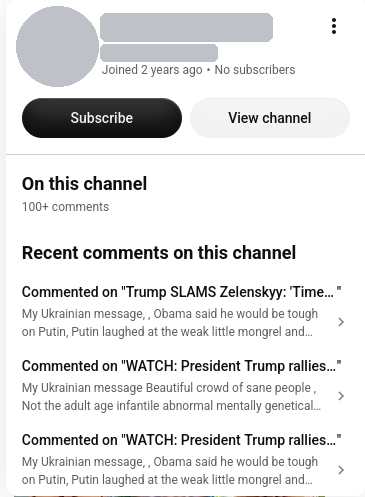

# botornot

Looks at the people commenting on a YouTube channel and scores each one for bot-like behaviour,
using only what any visitor can see: the comments they leave and their public profile card.

It comes in two forms that share the same code:

- **A command-line tool** – point it at a channel, video or post and get a CSV.
- **A small web service** – add channels, give each a schedule, and browse results over time.

> **Read this first**
> - Scores are heuristics, not verdicts. A high score means "worth a look", nothing more.
> - It uses YouTube's internal, undocumented endpoints. They can change without notice, and
>   automated use may be against YouTube's Terms of Service. The built-in waits are there on
>   purpose; speed them up at your own risk.
> - Results contain other people's comments. Keep the CSVs and the database private, and keep
>   the web page (which has no login) on your home network.

## Where the idea came from

I found this in the wild, on my phone. Tap a commenter's picture in YouTube and a profile card
slides up with their recent comments **on that channel**. One commenter's card showed the same
paragraph, almost word for word, under three unrelated videos:

<p>
  
  
</p>

*Left: the phone screenshot that started it. Right: another account, seen on the web. The
commenters' names and pictures are covered.*

Checking commenters one at a time like that works, but it is slow. botornot does the same check
for every commenter on a channel.

> [!NOTE]
> **How it really works.** That card comes from a single internal YouTube endpoint:
>
> ```
> POST https://www.youtube.com/youtubei/v1/account/get_profile_card
> ```
>
> It answers without a login. The request names the commenter and carries a small token saying
> which channel the card is being viewed on, and that channel decides which comments are listed.
> botornot calls it once per commenter, then compares the comments on the card with the ones the
> commenter left on the videos and posts it read. `card_context()` and `profile_card()` in
> `botornot.py` are the whole trick.

## Using it responsibly

- Treat a score as a reason to look, never as proof. Real people repeat themselves, share
  slogans and open new accounts.
- Do not publish results that name accounts, and do not use them to harass anyone. If a comment
  breaks YouTube's rules, report it to YouTube and let them decide.
- Go easy on YouTube: keep the default pace unless you have a reason, and scan only what you
  will actually review.

## What it checks

For each commenter it gathers their comments on the videos and posts it read, plus the few
comments YouTube shows on their profile card for that channel, and looks for:

| Signal | Points (default) |
|---|---|
| Near-identical comments on different videos | +3 |
| Near-identical comments on the same video or post | +2 |
| Reworded comments that say the same thing (optional "meaning check") | +2 |
| Account younger than about 5 weeks | +1 |

Everything is fetched anonymously: no API key, no login, no cookies.

The **meaning check** is off unless you ask for it. It compares what comments say rather than
how they are worded, using a small embedding model
([google/embeddinggemma-2](https://huggingface.co/google/embeddinggemma-2)) that runs on your
own machine, so comments are not sent to anyone. It needs extra packages and about 2 GB of RAM.

## Command-line tool

Needs Python 3.14, the version it is developed and tested on.

```sh
python -m venv .venv
.venv/bin/pip install -r requirements.txt

.venv/bin/python botornot.py @SomeChannel                                  # a channel: newest 5 videos + 5 posts
.venv/bin/python botornot.py "https://www.youtube.com/watch?v=VIDEO_ID"  # one video
.venv/bin/python botornot.py "https://www.youtube.com/post/POST_ID"      # one community post
```

It writes `@SomeChannel.csv` (or `<ID>.csv`): one row per comment, highest-scoring accounts first.
A channel scan with the default limits checks 100 commenters and takes a few minutes.

Options:

- `--meaning` – add the meaning check. First install its packages:
  `.venv/bin/pip install torch torchvision --index-url https://download.pytorch.org/whl/cpu`
  (the small CPU builds), then `.venv/bin/pip install -r requirements-meaning.txt`.
  The model (about 1.5 GB) is downloaded the first time.
- `--verbose` – log every request and wait.

Limits, weights and waits are the constants at the top of `botornot.py`.

## Web service

One **orchestrator** (the web page, the schedule, and a queue of small jobs) and a few
**workers** that each take one job at a time: list a channel, read one video's comments, or
check one commenter. The orchestrator decides when each request to YouTube may go out, so
adding workers does not hammer YouTube harder.

Try it on your own machine (needs Docker):

```sh
docker compose up -d --build
```

Then open <http://localhost:8080/botornot/>. The first build takes a while: the worker image includes
PyTorch so that the meaning check is available when you tick it.

On the web page you can:

- add a channel, video or post, with a schedule (manual, hourly … weekly);
- tick **meaning check** for the targets where you want it (it is off by default);
- start a scan by hand and watch it: a progress bar, the results filling in as accounts are checked,
  and the scan's live log underneath (every
  request and wait if you want that much), with a red banner if anything was logged as an error;
  cancel it if need be;
- read a scan's results and download the CSV;
- review an account: the comments that triggered its score are marked, and every comment has a
  link that opens that exact comment on YouTube (shown first, as the highlighted comment), where
  you can look at it in context and report it yourself from the comment's ⋮ menu;
- see a channel's scans over time and the accounts that keep scoring;
- change the dials under **Settings**: how many videos, posts and comments to read, how many
  commenters to check, every scoring weight and threshold, and the pace of requests;
- **start fresh** under Settings: delete all scans and results (targets and settings stay), or
  delete a single scan from its page;
- see under Settings who added, changed, started or deleted what, and from which address.

Every page keeps itself up to date; there is no need to reload. (A part of a page with a form you
are in the middle of editing waits until you save.)

If YouTube starts rate-limiting, the orchestrator pauses all work for a minute, doubling up to
an hour, and says so at the top of the page.

### Deploying to a server with Ansible

```sh
ansible-galaxy collection install community.docker
cp ansible/inventory.example.ini ansible/inventory.ini     # then put your server in it
ansible-playbook -i ansible/inventory.ini ansible/deploy.yml
```

The playbook copies the source to the hosts in the `docker_servers` group, builds the images
there and starts the containers. The server needs Docker with the compose plugin, and a login
user who may use Docker. Options: `-e botornot_workers=2`, `-e botornot_port=9000`,
`-e botornot_log=DEBUG`.

**Run the playbook again after every change to the source.** The containers run a copy of the
code, so they stay on the old version until the images are rebuilt. Scan data lives in the
`botornot-data` Docker volume and survives redeploys.

Looking after it afterwards is a second playbook, `ansible/manage.yml -e do=...`:

| `do=` | What it does |
|---|---|
| `status` (default) | Containers, whether the web page answers, Docker's disk use |
| `logs` | The containers' last log lines (`-e lines=200` for more) |
| `restart`, `stop`, `start` | As they say; scans in progress carry on afterwards |
| `clean` | Free disk space: Docker's build cache and old botornot images. Nothing in use is touched |
| `teardown` | Remove the containers. Images, scan data and the model stay, so a deploy brings it all back |
| `purge` | Teardown, then delete the images, scan data, model and source too. Needs `-e confirm=yes` |

```sh
ansible-playbook -i ansible/inventory.ini ansible/manage.yml -e do=restart
```

## Tests

```sh
.venv/bin/pip install -r requirements.txt -r requirements-service.txt -r requirements-dev.txt
.venv/bin/python -m pytest tests
```

The tests never contact YouTube; every reply is faked. They cover the scoring, the CSV output,
the retry and back-off logic, and the service end to end (add a target, run a scan through the
queue, logs and progress, settings, clean-up). GitHub Actions runs them on every push, builds the container image
and syntax-checks the playbooks (`.github/workflows/ci.yml`).

## What's where

| Path | What it is |
|---|---|
| `botornot.py` | The scanner and the command-line tool |
| `orchestrator.py`, `templates/` | The web page, schedule and job queue |
| `worker.py` | The worker that carries out jobs |
| `Dockerfile`, `compose.yaml` | The container images and how they run together |
| `ansible/` | The deploy and manage playbooks, their shared settings, an example inventory |
| `tests/` | The test suite |
| `docs/images/` | The screenshots in this README |
| `requirements*.txt` | Packages: the tool, the service, the meaning check, the tests |
| `CLAUDE.md` | Working notes: how the endpoints behave, what has been tested, open questions |

## Known limits

- Only top-level comments are read; replies are skipped, and a lot of spam lives in replies.
- A profile card shows at most 3 of the account's comments, and only those on the scanned channel.
- The scoring weights and the meaning threshold are first guesses, not tuned against confirmed bots.
- Where YouTube's rate limit sits is unknown; the default pace is simply the fastest one tried.
- The service keeps every scan until you delete it.

## License

GPL-3.0-or-later. See [LICENSE](LICENSE).
